# CampusRoute — Intelligent Campus Transportation Optimization

**[ LIVE INTERACTIVE DEMO — CLICK HERE](https://YOUR-GITHUB-USERNAME.github.io/campus-transit-optimization/)**

  

A shuttle-planning pipeline that models 14 campus stops as a weighted graph and applies classic algorithms (MST, shortest paths, greedy scheduling, knapsack DP, Travelling Salesman) to cut **modelled** average passenger waiting time from **6.69 to 2.03 minutes**. An interactive dashboard lets you explore the results in a browser.

> **Project origin.** This is a Design and Analysis of Algorithms (DAA) team project at Woxsen University. This repository is my individual portfolio copy; the original team repository is [ritheekyadav01-afk/DAA_PBL](https://github.com/ritheekyadav01-afk/DAA_PBL). See [Credits](#credits-and-acknowledgements) for the team and my own contributions.

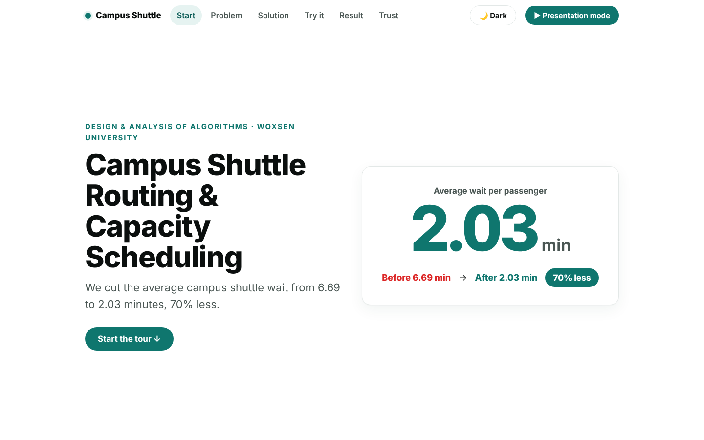

## Contents
1. [Overview and problem](#1-overview-and-problem) · 2. [Objectives](#2-objectives) · 3. [Algorithms](#3-algorithm-implementations) · 4. [How it works](#4-technical-explanation) · 5. [Architecture](#5-architecture) · 6. [Tech stack](#6-technology-stack) · 7. [Folder structure](#7-folder-structure) · 8. [Install and run](#8-installation-and-execution) · 9. [Sample output](#9-sample-output) · 10. [Results](#10-performance-results) · 11. [Complexity](#11-complexity-analysis) · 12. [Screenshots](#12-screenshots) · 13. [Testing](#13-testing) · 14. [Limitations](#14-limitations) · 15. [Future work](#15-future-improvements) · 16. [Documents](#16-academic-documentation) · [Credits](#credits-and-acknowledgements) · [Licence](#licence)

## 1. Overview and problem
A shuttle is only useful if passengers do not wait long. With one shuttle visiting stops in a fixed, unplanned order, loops are long and waits are high. The questions: which roads matter, what is the fastest route, how many drivers are needed, how should vehicles be loaded, what loop should be driven, and how many shuttles should run?

## 2. Objectives
- Model the campus as a weighted graph and solve each question with a suitable classic algorithm.
- Cross-check every algorithm against an independent method (e.g. Prim vs Kruskal, Held-Karp vs brute force).
- Quantify the effect on average passenger waiting time and show it in an interactive dashboard built from real algorithm output.

## 3. Algorithm implementations
| Question | Algorithm(s) | Module | Result on this data |
|---|---|---|---|
| Cheapest roads connecting all stops | Prim, Kruskal (union-find) | `src/mst.py` | 5.81 min total (both agree) |
| Fastest route between two stops | Dijkstra, Bellman-Ford | `src/sssp.py` | Bus Stop → Race Arena: 3.3 min |
| Fastest route for every pair | Floyd-Warshall | `src/apsp.py` | Longest shortest trip: 4.3 min |
| Driver shifts | Greedy earliest-finish interval scheduling | `src/greedy.py` | 1 driver covers 8 of 18 shifts; greedy assignment uses 4 drivers |
| Loading vehicles | 0-1 knapsack (dynamic programming) | `src/dp.py` | BUS-1 30/30 seats, BUS-2 19/20, VAN-1 9/12 |
| Best closed tour | Held-Karp (exact), nearest neighbour, MST preorder | `src/tsp.py`, `src/wait_model.py` | 13.37 (file order), 10.11, 10.11, **9.92 min (optimal)** |
| Waiting time | Loop-time model, demand weighted | `src/wait_model.py`, `src/sensitivity.py` | 6.69 → 2.03 min |

## 4. Technical explanation
- **Graph:** stops are vertices; roads are undirected edges weighted by straight-line (haversine) distance ÷ 20 km/h, in minutes.
- **Wait model:** with uniform arrivals, average wait at a stop = loop time ÷ 2, weighted by passengers per stop.
- **Baseline:** one shuttle visiting stops in file order. **Improved plan:** three shuttles, each looping one contiguous slice of the MST-based tour.
- **Dashboard:** `src/dashboard.py` runs the real algorithms, exports results as JSON and injects them into `src/dashboard_template.html`. The page loads no external resources.

## 5. Architecture
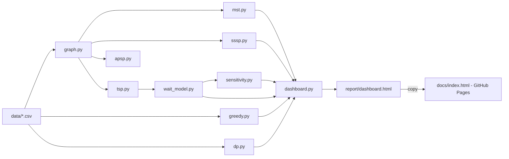

## 6. Technology stack
Python 3.10+, NumPy, Matplotlib, Pytest, Jupyter Notebook, and a self-contained HTML/CSS/JavaScript dashboard. Dependencies: [`requirements.txt`](requirements.txt).

## 7. Folder structure
```text
main.py                    entry point: runs the whole pipeline
data/                      stops.csv (real); edges, demand, fleet, shifts (estimates)
src/                       graph, mst, sssp, apsp, greedy, dp, tsp, wait_model,
                           sensitivity, experiments, dashboard (+ dashboard_template.html)
tests/test_algorithms.py   cross-check and dashboard tests
scripts/                   verify_results.py, make_figures.py
report/                    generated dashboard.html and charts (report/figures/)
docs/                      report (PDF, DOCX), index.html (live demo), screenshots/,
                           ARCHITECTURE.md, ALGORITHMS.md, RESULTS.md
final_review/              final review deck (PDF, PPTX)
notebooks/walkthrough.ipynb
```

## 8. Installation and execution
Requires Python 3.10+ and git.
```bash
git clone https://github.com/YOUR-GITHUB-USERNAME/campus-transit-optimization.git
cd campus-transit-optimization
python3 -m venv .venv
source .venv/bin/activate        # Windows: .venv\Scripts\activate
pip install -r requirements.txt
python main.py                   # runs every algorithm, writes report/
pytest -q                        # runs the tests
python scripts/verify_results.py # re-checks every reported number
python scripts/make_figures.py   # redraws the extra charts
```
Open `report/dashboard.html` in a browser. To refresh the live demo after changes: `python main.py`, copy `report/dashboard.html` to `docs/index.html`, then commit and push.

## 9. Sample output
```text
[MST] Prim total = 5.8 min, Kruskal total = 5.8 min, match = True
[SSSP] Dijkstra S2->S12: 3.3 min via Bus Stop -> Care and Cure -> Academic Blocks -> Library -> Oval -> Race Arena
[TSP] File order 13.37 | Nearest neighbour 10.11 | MST preorder 10.11 | Optimal (Held-Karp) 9.92 min
      MST approximation ratio = 1.019 (theory: <= 2.000)
[Wait] file-order 6.68, MST 5.05, after (3 shuttles) 2.03 min -> 70% improvement
```
(`main.py` prints 6.68 and the dashboard shows 6.69: the exact value is 6.685, rounded differently.)

## 10. Performance results
Re-run with `python main.py` on this repository's data.

| Configuration | Average wait (min) |
|---|---|
| One shuttle, file order (baseline) | 6.69 |
| One shuttle, MST tour | 5.05 |
| Three shuttles, MST tour slices | **2.03** |

Fleet size (MST tour slices): 1 → 5.05, 2 → 3.91, **3 → 2.03**, 4 → 1.75, 5 → 1.26, 6 → 1.12 min. Gains drop below 0.5 min per extra shuttle from the 4th shuttle on.

**Read the 70% carefully.** About 24 points come from better routing (6.69 → 5.05); the rest comes from running three shuttles instead of one. These are **simulated results on estimated data**, not measurements from real shuttle operations.

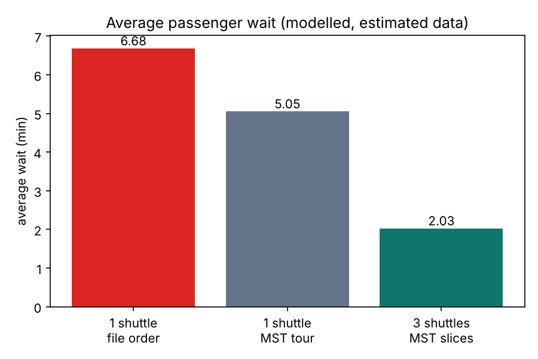
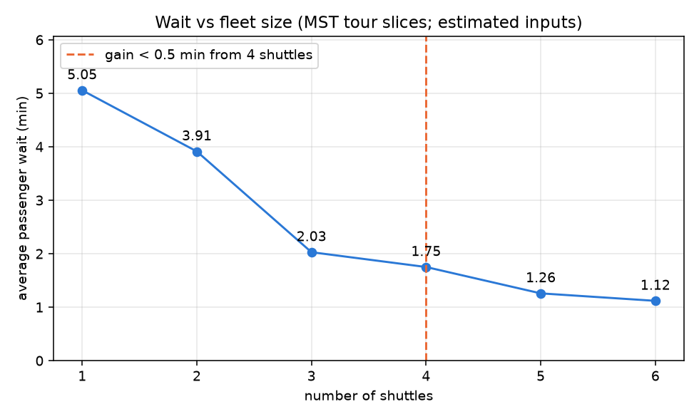
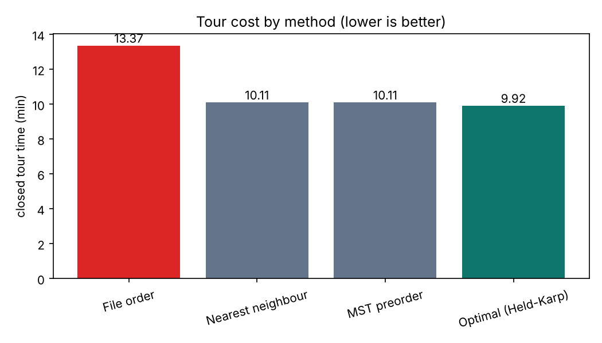

More detail: [`docs/RESULTS.md`](docs/RESULTS.md), [`docs/ARCHITECTURE.md`](docs/ARCHITECTURE.md), [`docs/ALGORITHMS.md`](docs/ALGORITHMS.md).

## 11. Complexity analysis
| Algorithm | Time | Space |
|---|---|---|
| Prim (binary heap) | O(E log V) | O(V+E) |
| Kruskal (union-find) | O(E log E) | O(V+E) |
| Dijkstra | O((V+E) log V) | O(V) |
| Bellman-Ford | O(VE) | O(V) |
| Floyd-Warshall | O(V³) | O(V²) |
| Interval scheduling | O(S log S) | O(S) |
| 0-1 knapsack | O(nW) | O(nW) |
| Held-Karp | O(n² 2ⁿ) | O(n 2ⁿ) |
| Nearest neighbour | O(n²) | O(n) |
| MST preorder tour | O(V log V) | O(V) |

Measured runtimes against these curves: `report/runtime_vs_complexity.png`.

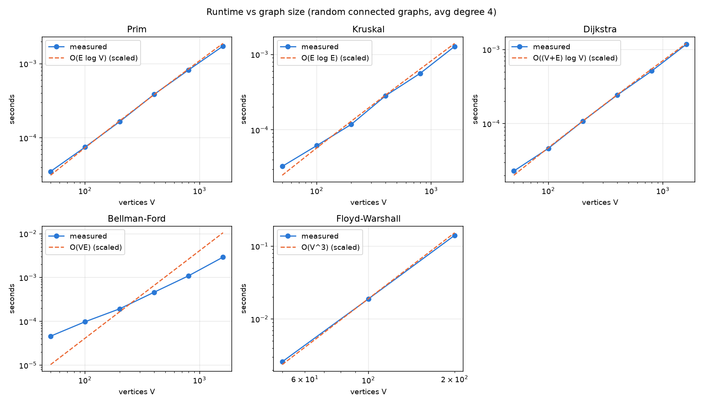

## 12. Screenshots
| | |
|---|---|
| 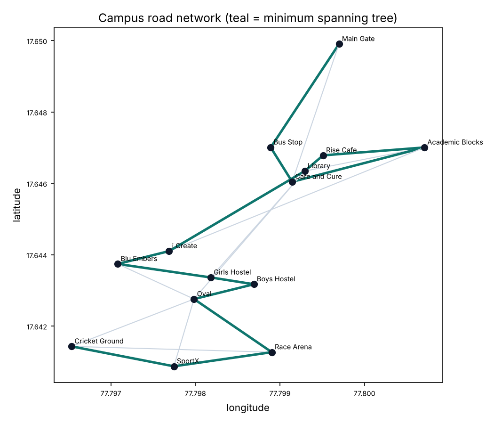 | 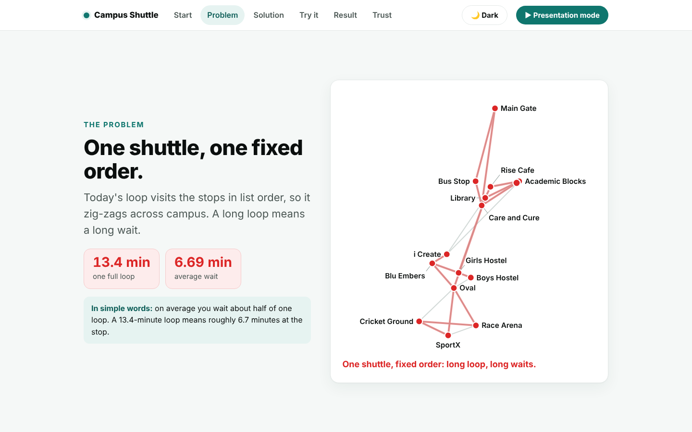 |
| 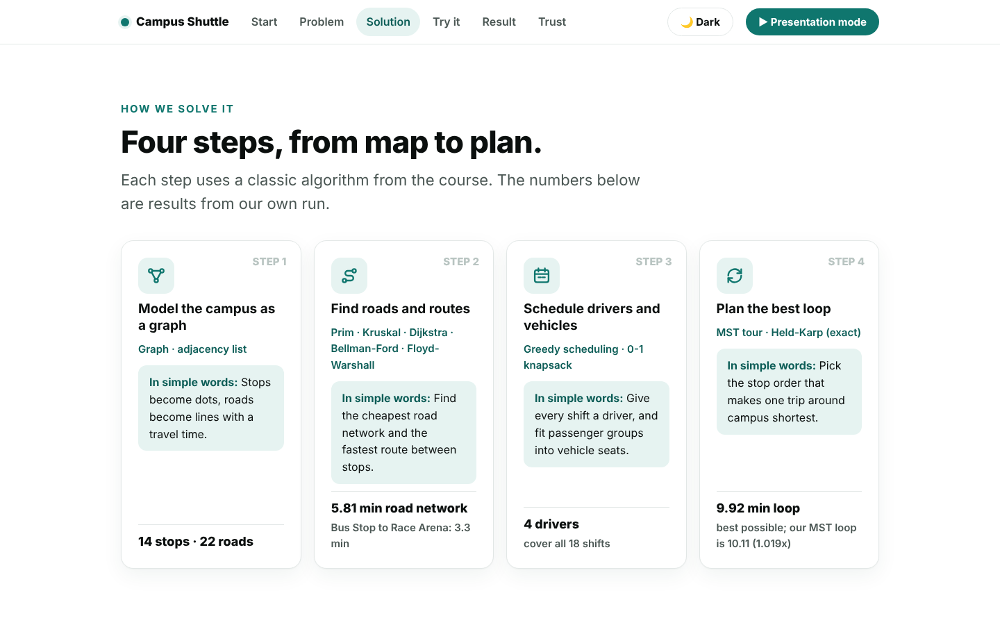 | 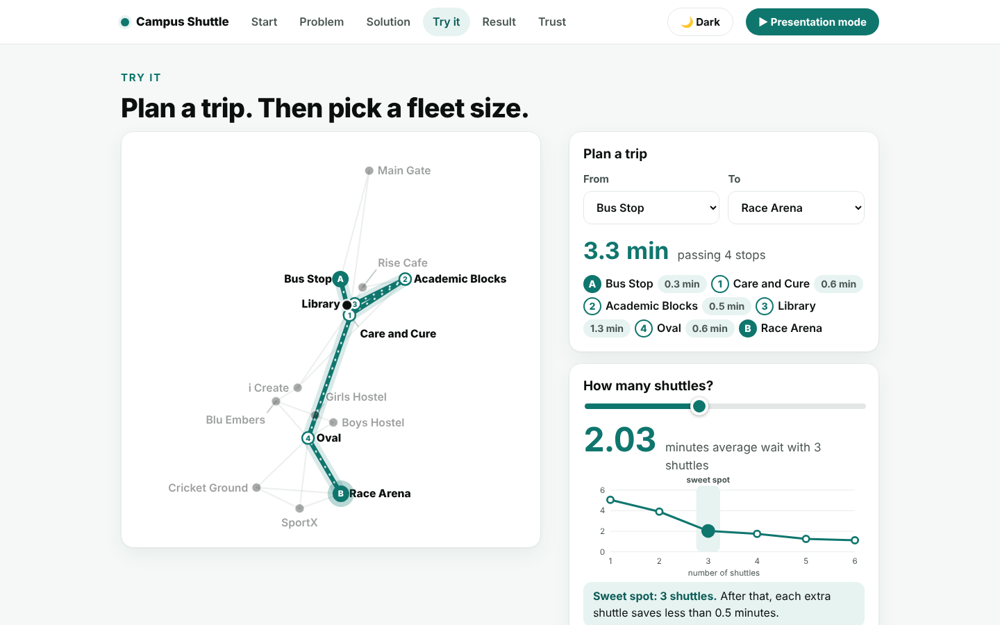 |
| 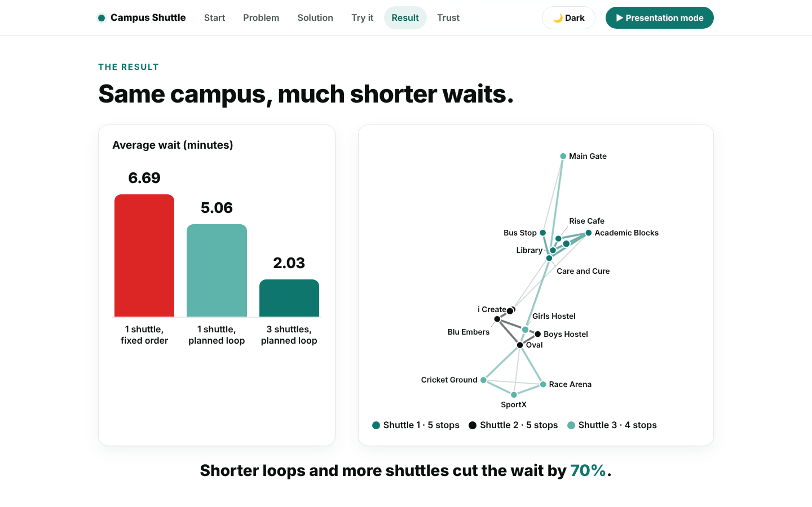 | 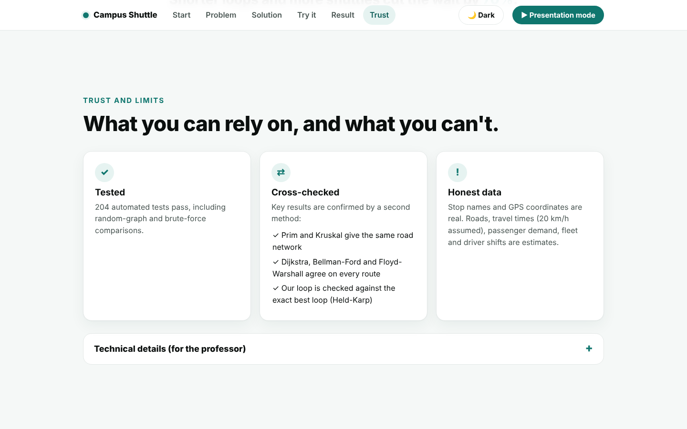 |

## 13. Testing
`pytest -q` runs **204 test cases**: Dijkstra vs Bellman-Ford vs Floyd-Warshall, Prim vs Kruskal, Held-Karp vs brute force and vs the heuristics, and knapsack vs brute force over many random seeds, plus two dashboard checks. `scripts/verify_results.py` re-derives the headline numbers (11 checks) (key numbers present, six sections, no external resources).

## 14. Limitations
- Only the stop coordinates are real. Roads, 20 km/h speed, demand, fleet and shifts are **estimates** (each CSV is marked `# ESTIMATE`).
- Straight-line distances, no dwell time, traffic or time-of-day demand.
- Shuttles run contiguous slices of one tour, not a full vehicle-routing optimisation; slices are balanced by stop count, so loop times are uneven.
- The greedy driver assignment is a heuristic (it uses 4 drivers; 3 are enough for the 18 shifts).
- Not tested on real campus operations.

## 15. Future improvements
Not implemented yet: survey real roads and boardings, add dwell time and time-of-day demand, try a vehicle-routing heuristic, balance shuttle loops by time.

## 16. Academic documentation
- Report: [PDF](docs/DAA_Project_Report.pdf) · [DOCX](docs/DAA_Project_Report.docx)
- Final review deck: [PDF](final_review/DAA_Campus_Shuttle_Deck.pdf) · [PPTX](final_review/DAA_Campus_Shuttle_Deck.pptx)
- Notebook: [`notebooks/walkthrough.ipynb`](notebooks/walkthrough.ipynb)

## Credits and acknowledgements
DAA team project, Woxsen University, B.Tech CSE (AI & ML), faculty Dr. Syed Javeed Pasha

Team: G Madhan , D Ritheek , M. Srilakshmi, B. Deekshan, P. Priyakaran, .

**My contribution (G. Madhan), as listed in the project report:** wait-time model, fleet-size sensitivity, nearest-neighbour and MST-preorder tours, interactive dashboard, presentation script and viva preparation. The other algorithms were implemented by teammates.

The dashboard front end (`src/dashboard.py`, `src/dashboard_template.html`) was built with Claude Code (Anthropic's AI coding assistant); the team reviewed and tested it, and all numbers come from the Python code.

References: Cormen et al., *Introduction to Algorithms*; Kruskal (1956); Prim (1957); Dijkstra (1959); Bellman (1958); Floyd (1962); Held and Karp (1962); Rosenkrantz, Stearns and Lewis (1977). Full list in the report.

## Licence
No licence file is included: the original team repository has none. Add one (for example MIT) only after agreeing it with all team members.
