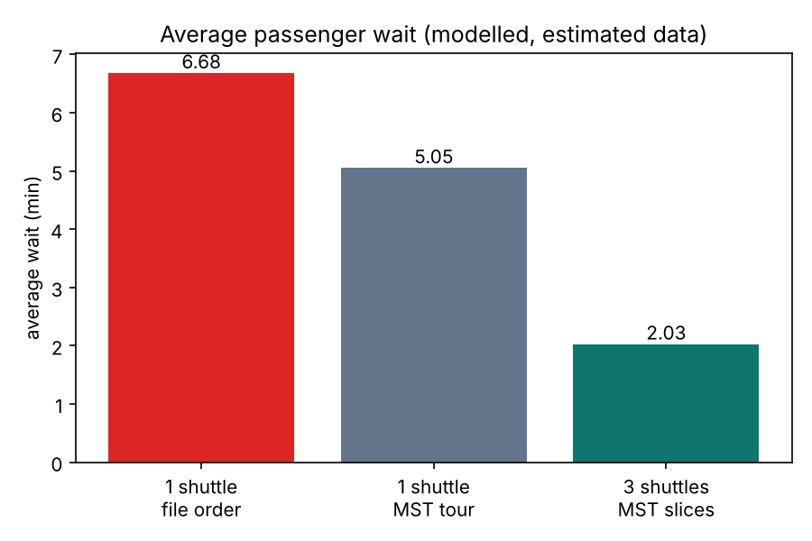
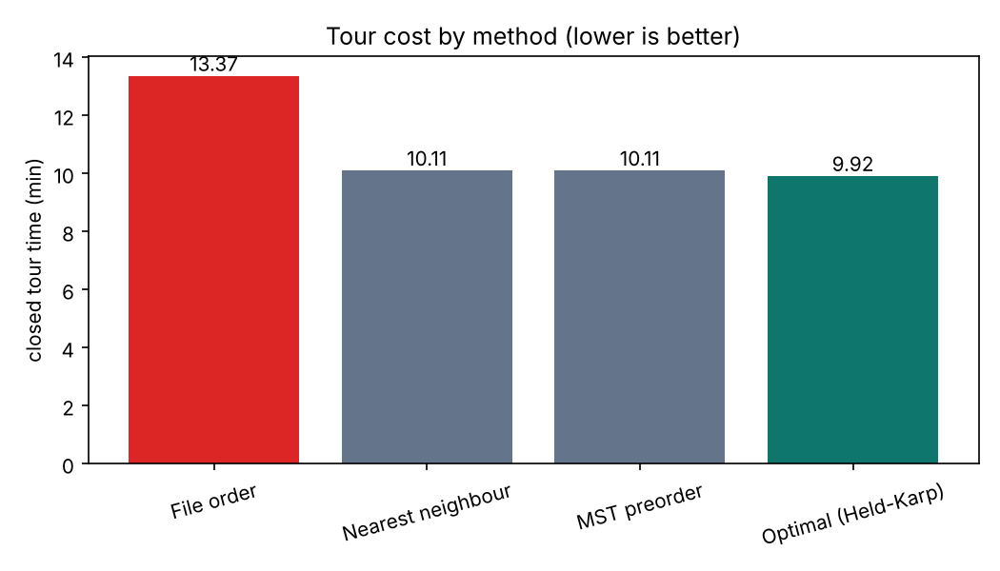

# Results

All numbers come from `python main.py` and are re-checked by `python scripts/verify_results.py`. They are **modelled results on estimated data**, not real shuttle measurements.

| Item | Value |
|---|---|
| MST total (Prim = Kruskal) | 5.81 min |
| Tour: file order / nearest neighbour / MST preorder / Held-Karp | 13.37 / 10.11 / 10.11 / 9.92 min |
| MST tour vs optimal | 1.019x (theory guarantees at most 2x) |
| Average wait: 1 shuttle file order | 6.69 min (exact 6.685) |
| Average wait: 1 shuttle MST tour | 5.05 min |
| Average wait: 3 shuttles, MST slices | 2.03 min |
| Fleet size 1 to 6 | 5.05, 3.91, 2.03, 1.75, 1.26, 1.12 min |

## How to read the 70%
- Routing alone (file order to MST tour): 6.69 to 5.05, about 24% lower.
- Using 3 shuttles instead of 1: the rest of the drop, to 2.03.

## Other honest notes
- 3 drivers are enough for the 18 shifts; the greedy assignment uses 4 because it is a heuristic.
- The 3 shuttle loops are uneven because slices are balanced by stop count, not loop time.
- Only `stops.csv` is real data; roads, speed (20 km/h), demand, fleet and shifts are estimates.

